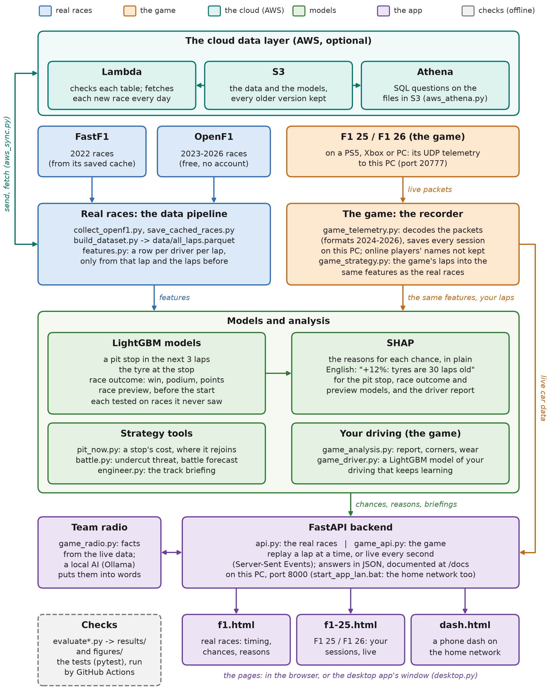

# F1 Strategy Predictor

[](https://github.com/MK-Dev-Coder/F1Telemetry-Tracking/actions/workflows/tests.yml)

Predicts when a Formula 1 driver will make a pit stop, which tyre they will fit and how the race will end
(each driver's chance to win, finish on the podium and score points), explains every prediction in plain
English with SHAP, and replays past races lap by lap in the browser.

MSc dissertation project, Big Data Engineering & Data Science (AthTech / University of York).

## For examiners

- **The study's tables** are in [`results/`](results/), each with the script that makes it, and the charts in
  [`figures/`](figures/). How the parts fit together: [`figures/architecture.png`](figures/architecture.png).
- **The test races** are the first 17 of 2026, which no model saw while it was built (`TEST_LAST_ROUND` in
  `features.py`): the pit stop, tyre and race outcome models are trained on 2022–2024, tuned on 2025 and trained
  again on 2022–2025 before the test. The race preview is tested race by race, each time trained only on the races
  before it.
- **The trained models are here** (`models/`), the race data isn't: it belongs to Formula 1. To run the app or
  train the models again, see [Install](#install) and [Get the data](#get-the-data) (about 30 minutes to download).
- **The tests** (`python -m pytest tests`, 193 of them) run on GitHub Actions on every push (the badge above).
  Without the data folder the 32 that read it are skipped and the other 161 run.
- **The cloud data layer** (optional; the app runs without it): the data and models in Amazon S3 with versions, a
  Lambda check on each table that arrives, Athena for SQL, and a daily Lambda that fetches each new race
  ([AWS_SETUP.md](AWS_SETUP.md)); the desktop app (`desktop.py`) fetches the newest data from it and builds new races.
- **Licence:** the code is under the [MIT licence](LICENSE); the data, names, logo and photos belong to their
  owners.

## What it does

- **Pit stop chance.** Every lap, for every driver: the chance of a pit stop in the next 3 laps.
  Above the alert line the app shows "Box?" (pit soon).
- **Reasons.** Each chance is explained with SHAP, for example "+12%: tyres are 30 laps old".
- **Tyre pick.** The compound the driver would most likely fit if they pitted now.
- **Race outcome.** Every lap, for every driver: the chance to win, to finish on the podium and to score
  points, the likely finishing position, and why (SHAP), for example "+16%: P2 needs 0.6 s a lap to catch them".
- **If they pit now.** Where a driver would rejoin, the gaps to the cars around them after the stop and how
  their chances change, for example "a stop costs about 22 s here: Antonelli would rejoin P5, 1.7 s behind
  Russell; win chance 70% → 29%". A stop under a safety car or VSC costs less, as the data shows; under a red
  flag new tyres cost no time.
- **Car against car.** The **undercut threat** ("if Piastri pits now and Norris pits next lap, Piastri comes out
  ahead in 12% of the real undercuts like this"), the **battle forecast** ("Leclerc gains 1.29 s a lap: within
  1 s in about 6 laps") and the **strategy battle**: two drivers side by side, with the gap between them lap by
  lap, their stops and tyres.
- **Race engineer.** An Engineer tab in the F1, F1 25 and F1 26 pages: the briefing for the track, how many laps
  each tyre lasts there and how fast it wears (shorter on a hotter day, and in the game's shorter races), the
  strategies the finishers used, what the winners did, what a pit stop costs and the safety car chance. In a replay
  it knows only the races there before that one (no spoilers). In the game it also shows **the game's own plan**:
  the pit window from its strategy screen, where you'd rejoin, and how long it says each tyre lasts.
- **Race preview.** Before the next race (now the Mexico City Grand Prix), each driver's chance to win,
  finish on the podium and score points, and why, from what is known before the start.
- **Replay mode.** Step through any race from 2022 to 2026, or press Play to watch it lap by lap as if it
  were live. Real stops and tyres stay hidden until you tick "Show what really happened".
- **F1 25 telemetry.** Your own sessions from the F1 25 video game (PS5, Xbox or PC), recorded live while
  you drive: speed, throttle and brake on every lap, lap against lap, tyre wear and the track map.
- **F1 26 section.** Sessions with the 2026 cars from F1 25's 2026 Season Pack, on their own page, with
  what the 2026 format adds: active aero, overtake mode and the energy limit per lap.
- **Your game, analysed.** A report after each session (result, places lap by lap, consistency, your pace against
  the cars around you, your theoretical best lap), where you lose time corner by corner, lock-ups and wheelspin
  on the track map, your own tyre wear forecast, energy per lap, overtake mode and active aero (F1 26), you
  against your Time Trial rival, when to switch to the wet tyres, your progress at each track, setups side by
  side, and a **phone dash**: your race in big numbers on a second screen.

## Results

Every model is trained on 2022–2025 and tested on the first 17 races of 2026 (up to Singapore), which it never saw.
Races added after that (the 2026 United States GP) are used by the app and the race preview only, so the
numbers here stay the same when the scripts are run again (`TEST_LAST_ROUND` in `features.py`). The tables
behind them are in `results/` (the scripts write them to `data/`, which isn't in the repository).

**Pit stop in the next 3 laps** (561 pit stops in the test races)

| Model | PR-AUC | Pit stops warned 1–3 laps ahead |
|---|---|---|
| Random guess | 0.09 | |
| Tyre age rule | 0.13 | 41% |
| Logistic regression | 0.26 | 47% |
| **LightGBM** | **0.32** | **53%** |

**Which tyre at the pit stop** (577 pit stops in the test races)

| Model | Right tyre | Right tyre in the top 2 |
|---|---|---|
| Always HARD | 47% | |
| Strategist rule | 59% | |
| Logistic regression | 66% | 88% |
| **LightGBM** | **71%** | **88%** |

**Evaluation** (`python evaluate.py`, all on 2026):

- PR-AUC 0.32 with a 95% confidence interval of 0.27–0.39 (whole races resampled); LightGBM beats the
  logistic regression in 95% of the resamples and the tyre age rule in all of them.
- The percentages can be trusted: calibration error 0.023. Normal stops are warned 63% of the time and
  safety car stops 46%; stops on tyres under 8 laps old (damage, punctures) and wet stops are missed.
  A third of the false alarms are just early: the stop comes 4–6 laps later.
- SHAP: tyre reasons come first before 71% of correctly warned stops. The top reason stays the same on
  the next lap 81% of the time (18% for two random laps). Taking the top reason away lowers the chance
  by 23 points, against 3 points for a random one.
- Speed: one lap for all drivers takes about 6 ms in replay. Live on F1 25, everything after a lap (the
  laps so far, features, both models, every car's reasons) takes about 75 ms, and the page gets it within a
  second (it asks every second).

The full tables are in `results/evaluation.md`, and the charts are `figures/eval_*.png`.

**Why "the next 3 laps", and what each group of features adds** (`python evaluate_design.py`, tables in
`results/horizon.md` and `results/feature_groups.md`, charts `figures/eval_horizon.png` and
`figures/eval_feature_groups.png`). The same model, trained and tuned the same way, for a stop in the next 1, 2, 3
or 5 laps. A longer window is easier to hit, so each PR-AUC is set against its own random guess:

| Horizon | Laps with a stop coming | PR-AUC (95% interval) | Times the random guess |
|---|---:|---|---:|
| 1 lap | 2.9% | 0.215 (0.178–0.259) | 7.4 |
| 2 laps | 5.8% | 0.267 (0.227–0.315) | 4.6 |
| **3 laps (the study)** | 8.6% | **0.320 (0.270–0.388)** | 3.7 |
| 5 laps | 14.2% | 0.432 (0.358–0.525) | 3.0 |

A 1-lap warning is the sharpest against its random guess but comes too late to plan a stop; 5 laps is easier to hit
but says less about when. Three laps leaves time to plan and is still 3.7 times a random guess. Trained again
without one group of features at a time: without the tyres the PR-AUC falls to 0.224 (−0.097, lower in every
resample), without the other cars' stops by 0.032 and without the gaps by 0.021; the safety car, weather, pace and
track groups move it by less than 0.01. Without race progress (lap number, laps left) it is 0.037 better on 2026
(0.000 to +0.068), though those features help on 2025 (0.360 against 0.344 when tuning). The stops came at the same
points of the race as before (half of the laps with a stop coming were between 26% and 61% of the race in 2026,
24–62% in 2025), so that isn't the reason; it is still open. The study keeps the model picked on 2025: choosing
features on the test races would use the test to choose.

**Race outcome** (every lap of the 17 test races; log loss, lower is better)

| Model | Win | Podium | Points | Finish error (places) |
|---|---|---|---|---|
| Grid only (where they started) | 0.096 | 0.207 | 0.481 | 2.68 |
| Position only (where they are now) | 0.087 | 0.168 | 0.358 | 2.03 |
| **LightGBM** | **0.066** | **0.152** | **0.346** | **1.86** |

`python evaluate_race_model.py` (all on 2026, tables in `results/race_evaluation.md`, charts `figures/race_*.png`):

- Win log loss 0.066 with a 95% confidence interval of 0.048–0.086 (whole races resampled); LightGBM beats
  "position only" in 100% of the resamples for the win and 98% for the podium (81% for the points).
- The percentages can be trusted: calibration error 0.015 (win), 0.013 (podium), 0.030 (points).
- It gets better as the race goes on, and from a quarter of the way in it beats both baselines. At the start
  of a 2026 race the grid is the better guide: in 2026 the leader after lap 1 often wasn't the winner, which
  the 2022–2025 races didn't teach it. In the last 10% "position only" is about as good.
- SHAP: 12 of 15 reasons push the chances the way racing logic says (more places to make up: lower;
  quicker than the car ahead: higher). Each reason is measured against an average driver (3% to win, 16% for
  a podium, 59% for points), and the reasons add up exactly to the model's chance.
- Speed: all the chances and the reasons for one lap take about 0.2 s.

**Do the models learn the 2026 rules?** (`python evaluate_rolling.py`, tables in `results/rolling_2026.md`, chart
`figures/rolling_2026.png`.) Each model is trained again before every 2026 race (rounds 2–17), with the 2026 races
before it added, and tested on that race, as a team would through a season:

| Model | Trained on 2022–2025 | + the 2026 races so far | Change (95% interval) |
|---|---|---|---|
| Pit stop, PR-AUC | 0.387 | 0.394 | +0.007 (−0.007 to +0.021) |
| Tyre pick, right compound | 72.5% | 73.7% | +1.1 points (−0.8 to +2.9) |
| Race outcome, win log loss | 0.066 | 0.065 | −0.001 (−0.002 to 0.000) |
| Race outcome, win log loss in the first quarter of a race | 0.102 | 0.099 | −0.003 (−0.006 to 0.000) |

The models carried over to the new rules well: adding up to 16 races of 2026 (counting them once or three times)
moves them only a little, and the clearest gain is at the start of a race, where the grid beat the race outcome
model. The tyre model still picks soft too rarely (26% against 31% really fitted).

**Race preview** (`python race_preview.py`, tables in `results/preview_evaluation.md`, chart
`figures/preview_backtest.png`). Before each of the 41 races of the study (2025, and 2026 up to round 17) the model
was trained again on every race before it (from 2022), then asked about that race. The app also shows the races
after them (the United States GP), but they aren't in these numbers:

| Way | Win log loss (95% interval) | Podium log loss | The favourite won |
|---|---|---|---|
| The last race's winner wins again (rule) | | | 37% |
| The season's points leader wins (rule) | | | 27% |
| Recent form only (table) | 0.147 (0.132–0.161) | 0.280 | 22% |
| **Before qualifying (LightGBM)** | **0.131 (0.119–0.144)** | **0.248** | 32% |
| The grid only (table) | 0.090 (0.074–0.109) | 0.200 | 68% |
| **After qualifying (LightGBM)** | 0.096 (0.087–0.105) | **0.189** | 63% |

Before qualifying it beats recent form on every score. After qualifying the grid says almost everything: in
2025–2026 the pole sitter won 68% of the races (46% in 2024), so for the win the grid alone is as good, while the
model is better for the podium. Its features are given against the top-k line, and the chances of the field
are fitted together, as in the race outcome model; the after-qualifying features (grid, race pace, season wins)
and the settings were picked the same way on 2024. One race has a lot of luck in it: a 30% favourite loses
most of the time.

**Undercut threat and battle forecast** (`python battle.py`, tables in `results/battle_evaluation.md`). What an
undercut gains is learned from the 229 real undercuts of 2022–2025: the car behind pitted one lap before the car
just ahead, both under green on dry tyres, and the gap is measured before the first stop and after the second.
It gains more when the car ahead's tyres are worn (seconds slower than its best lap on this set):

| Car ahead's tyre wear | Undercuts | Usual gain (middle half) |
|---|---:|---|
| under 0.3 s | 47 | 0.2 s (−0.9 to 1.9) |
| 0.3–0.7 s | 76 | 0.6 s (−0.6 to 2.4) |
| 0.7–1.2 s | 65 | 0.7 s (−0.8 to 2.3) |
| over 1.2 s | 41 | 1.3 s (−0.3 to 2.4) |

The chance shown is the share of those undercuts, on tyres worn about as much, that gained more than the gap. On
the 33 real undercuts of the 2026 test races (9 worked, 27%):

| Way | Brier score (lower is better) | Right at 50% |
|---|---:|---:|
| **The chance by tyre wear (the app)** | **0.140** | 82% |
| The chance without tyre wear | 0.146 | 82% |
| How often undercuts worked in 2022–2025 (19%) | 0.206 | 73% |

The battle forecast takes both cars' pace over their last 5 green laps (the race outcome model's pace) and says
how many laps until the gap is under 1 second. On the 6,882 laps of the 2026 test races where a car was 1–10 s
behind the car ahead under green (checked only while both cars stayed out under green):

| Way | Said within 1 s in 5 laps | It happened | Of those that happened, foreseen | Error in laps (median, mean) |
|---|---:|---:|---:|---|
| **Pace over the last 5 green laps (the app)** | 744 | **68%** | 54% of 936 | 1, 1.3 |
| The gap's change over the last 3 laps | 772 | 66% | 55% of 936 | 1, 1.3 |

Both are small, honest tools: the undercut chance beats the base rate clearly, but tyre wear adds only a little,
and the 2026 test has only 33 undercuts. The forecast is right about two times in three and off by about a lap.

## How it works



- One row per driver per lap, with 27 features known at the end of the lap: tyres, race progress, pace,
  gaps, what the cars around did, track status (safety car, VSC, yellow) and weather.
- A "real" pit stop needs new tyres, under 90 s in the pit lane and no red flag, so drive-throughs and
  cars waiting in the pit lane don't count.
- Every model is trained on 2022–2024, tuned on 2025, retrained on 2022–2025 and tested on 2026.
- The race outcome model is one LightGBM model that answers "will this driver finish in the top k?" for
  every k from 1 (a win) to 20, told that a bigger k can only mean a bigger chance. Its features are given
  against the line that matters (for the podium: places and seconds to P3), and the chances of all drivers
  on a lap are fitted together: one winner, three podium places, ten points places.

## Install

You need Python 3.12 and about 600 MB of disk space (mostly the Python packages). These commands are for Windows (cmd).
On macOS or Linux, use `source .venv/bin/activate` instead of the second line.

```bat
git clone https://github.com/MK-Dev-Coder/F1Telemetry-Tracking.git
cd F1Telemetry-Tracking
python -m venv .venv
.venv\Scripts\activate.bat
pip install -r requirements.txt
```

## Get the data

The race data is not in this repository: it belongs to Formula 1. There are two ways to get it.

**A. You were given the data files.** Put them in a folder called `data` and go to the next section.
`all_laps.parquet` is enough to train the models and run the app. The live timing screen also uses
`timing.parquet`, `race_control.parquet`, `tracks.json`, `team_colours.json` and `driver_names.json`;
without them it still works, just with no sector times, mini-sectors, race control messages or track maps.

**B. Download it yourself** (about 30 minutes):

```bat
python collect_openf1.py
python save_cached_races.py
python build_dataset.py
python build_timing.py
```

- `collect_openf1.py` downloads every finished race from 2023 on from [OpenF1](https://openf1.org)
  (free, no account). Don't run it while an F1 session is live: OpenF1 closes to free users then, and
  the script waits until it opens again. Run it again after each new race to add it.
- `save_cached_races.py` saves the races that are in FastF1's cache folder `fastf1_cache` (2022, plus two
  more). **FastF1 can no longer download new races**: since October 2026 F1's timing archive needs an
  F1 TV login ([FastF1 issue #978](https://github.com/theOehrly/Fast-F1/issues/978)), so
  `collect_data.py` would wait forever. Without a `fastf1_cache` folder, the dataset starts in 2023.
- `build_dataset.py` joins both sources into `data/all_laps.parquet`, with a `Source` column.
- To add a new race (for example the 2026 United States GP, round 18): `python collect_openf1.py 2026 18`, then
  `build_dataset.py`, `features.py`, `build_timing.py`, `race_preview.py` and `engineer.py` (the app builds its replay file and
  the final results itself). The study's numbers don't change (see Results). With the cloud set up, this happens by
  itself: see "New races by themselves" in The cloud data layer.
- `build_timing.py` saves what the live timing screen needs: sector times, mini-sectors (2023 on), speed traps,
  race control messages, team colours, driver names, and one lap of car positions per circuit to draw
  the track maps (downloaded once from OpenF1).

To check the data: `python check_data.py` counts the saved races, and `python compare_sources.py`
compares FastF1 and OpenF1 lap by lap on the races we have from both.

## Train the models

```bat
python features.py
python train_pit_model.py
python explain_pit_model.py
python train_tyre_model.py
python evaluate.py
python evaluate_design.py
python train_race_model.py
python evaluate_race_model.py
python evaluate_rolling.py
python pit_now.py
python race_preview.py
python battle.py
python engineer.py
```

| Script | Takes | Saves |
|---|---|---|
| `features.py` | ~5 s | `data/features.parquet` |
| `train_pit_model.py` | ~20 s | `models/pit_model.*`, `data/model_results.csv`, `figures/pr_curve_2026.png` |
| `explain_pit_model.py` | ~10 s | SHAP charts and 5 case studies in `figures/`, `data/case_studies.txt` |
| `train_tyre_model.py` | ~5 s | `models/tyre_model.*`, `data/tyre_model_results.csv`, `figures/tyre_confusion_2026.png` |
| `evaluate.py` | ~30 s | `data/evaluation.md` (every table for the results chapter) and `figures/eval_*.png` |
| `evaluate_design.py` | ~2 min | `results/horizon.md` and `results/feature_groups.md` (with their .csv), `figures/eval_horizon.png`, `figures/eval_feature_groups.png` |
| `train_race_model.py` | ~2 min | `models/race_model.*`, `models/race_background.parquet` (SHAP's average driver), `data/race_results.parquet`, `data/race_model_results.csv`, `data/race_test_predictions.parquet` |
| `evaluate_race_model.py` | ~3 min | `data/race_evaluation.md` and `figures/race_*.png` |
| `evaluate_rolling.py` | ~10 min | `data/rolling_2026.md`, `data/rolling_2026.csv`, `figures/rolling_2026.png` (retrains all three models 32 times) |
| `pit_now.py` | ~10 s | `models/pit_now.json`: what a stop costs under green, the safety car and the VSC |
| `race_preview.py` | ~1 min | `data/preview_backtest.parquet`, `data/preview_evaluation.md`, `figures/preview_backtest.png`, `models/preview_next.json` (the next race) |
| `battle.py` | ~5 s | `models/battle.json` (what the real undercuts gained), `data/battle_evaluation.md` |
| `engineer.py` | ~5 s | `models/engineer.json`: each track's tyre life and wear, strategies, winners and facts |

## Tests

```bat
python -m pytest tests
```

193 tests, about 10 seconds. GitHub Actions runs them on every push (`.github/workflows/tests.yml`), without the
data. They check:

- **The features:** real stops are found (not drive-throughs, not tyre changes under a red flag), and no feature
  uses a later lap: each lap's features are the same whether or not the rest of the race exists.
- **The study:** the saved test answers are on the 17 test races of 2026 only (the United States GP is app-only).
- **The race outcome:** one winner, three on the podium and ten in the points on every lap; a podium chance is
  never below the win chance; the top-k line; a leader who must still stop is really behind.
- **SHAP:** the reasons add up to the model's chance, for the pit stop and the race outcome models.
- **If they pit now:** what a stop costs under green, the safety car, the VSC and the red flag, and where the
  car rejoins (nothing when cars are missing from the timing).
- **Car against car:** every car is against the car just ahead; the laps until within 1 s; the undercut chance
  is the share of real undercuts that gained more, and it is left out under a safety car, on wet tyres, on an
  in-lap or out-lap, on a new set or too late in the race; the real undercuts are found in the laps; the strategy
  battle's gaps, stops and stints.
- **The race preview:** each race's preview uses only the races before it.
- **The engineer:** a hotter day wears the tyres faster and they last less (at most 40% either way), a shorter game
  race as many laps less, a stop under the safety car costs less, rain adds the intermediates and wets, a replay
  knows only the races before it, and the game's first pit window is kept as its plan.
- **F1 25 / F1 26:** bad packets are skipped, online players' names are never kept, short races are scaled, and
  the team radio sends each question to the right topic ("chance of rain?" is about the weather).
- **Your game, analysed:** clean laps leave out the start, pit laps and slow laps; the theoretical best is the best
  three sectors; the wear forecast reaches 70% on time; a corner where you're slower loses time; lock-ups and
  wheelspin are found (and hot spots on two laps); energy from the battery and from the game's counters; a pass
  counts for overtake mode; the Time Trial packet; the wet-tyre call against what a stop costs; your progress.
- **The driver report:** a corner against your best lap (braking point, corner speed, the time it cost); the model
  finds the habit that costs the time and beats a plain average on sessions it didn't see; too little driving says
  so; it keeps learning (a new or longer session is added, nothing else is read again, the live one waits); your
  start from the game's reaction time or from when the car first moves, and the places your quicker starts make.
- **The app:** its web answers, as the pages get them (for example, a replay speed of 0 is refused), and without
  `team_colours.json` the drivers are just grey.
- **The cloud and the desktop app** (with a made-up bucket in memory, no AWS needed): the game's data never goes up;
  a new PC gets every file exactly as sent; nothing changed, nothing sent; a file changed on one PC is never replaced
  by an older copy, and one changed on both sides is left alone; a download that doesn't match its SHA-256 is
  refused; the access key can't delete; the Lambda check finds laps listed twice and missing columns, and spots a
  file that isn't the one sent; the Athena tables' columns; the app window is a program of its own. New races: the
  daily fetch takes only finished races that aren't built or waiting already (not cancelled ones, not ones OpenF1 has
  no laps for yet) and stores them as `collect_openf1.py` does; the PC builds a new race with the README's steps in
  order, runs them again after a failure, and never sends its note to the cloud.

Most tests use small made-up races. The 32 in `tests/test_with_data.py` read the data folder and the trained
models without changing them; without the data folder they are skipped and the other 161 still run. The tests
don't listen for the game, so they can run while the app is open.

## Run the app

```bat
python api.py
```

Then open <http://127.0.0.1:8000>. The first start takes about 5 seconds while it builds
`data/replay_laps.parquet`. The API itself is documented at <http://127.0.0.1:8000/docs>.

The start menu has three buttons: **F1** for real races, **F1 25** for your own game sessions, and **F1 26**
for your sessions with the 2026 cars (F1 25's 2026 Season Pack).

### The desktop app

`python desktop.py --shortcut` puts **F1 Strategy Predictor** on the desktop. A double-click starts the app on this
PC and opens it in a window of its own (Edge or Chrome, with no address bar); closing the window stops it. If the app
is already running, it just opens a window on it. It works without AWS; when this PC is set up for it (below), it
first fetches any newer data from the cloud. What it did is in `desktop.log` (in `AppData\Local\F1 Strategy
Predictor`).

### The cloud data layer (AWS)

Optional: a safe copy of the data and the models, which another PC can fetch in a minute. Setting it up takes about an
hour, step by step in [AWS_SETUP.md](AWS_SETUP.md).

- **S3** (`python aws_sync.py upload`): everything in `data/` except the game's recordings (`data/f1_25`) and the
  driver report made from them (`data/driver`), which never leave this PC, plus `models/`: about 240 files, 25 MB.
  Only what changed goes up. Each file goes with its SHA-256, and a download that doesn't match it is refused; with
  the bucket's versioning on, S3 keeps every older copy. `python aws_sync.py download` fetches what changed: a file
  changed on this PC since the last sync is never replaced, and an upload never replaces a newer copy in the cloud.
- **Lambda** (`aws_check.py`, run by AWS on each table that arrives): did it arrive whole (its SHA-256), its rows,
  seasons and races, and for the lap tables missing columns, laps listed twice, missing lap times and tyres the
  timing didn't name. A report for each table goes in the bucket's `checks/`.
- **Athena** (`python aws_athena.py setup`, then `python aws_athena.py ask`): questions in SQL straight on the files
  in S3 (races and laps per season, tyre stints per race, the share of laps on each tyre, how long a set lasts), each
  with the time Athena took and the data it read.
- **New races by themselves** (`aws_fetch.py`, `newraces.py`): every morning at 06:00 UTC an EventBridge schedule
  runs a second Lambda, which fetches any Grand Prix that has finished from OpenF1 into the bucket, exactly as
  `collect_openf1.py` saves a race. When the desktop app starts, it builds the new race in the background with the
  usual steps (`collect_openf1.py`, `build_dataset.py`, `features.py`, `build_timing.py`, `race_preview.py`,
  `engineer.py`), sends the results back so every PC gets it, and says when it's in. Tested by fetching the 2026
  United States GP again: the cloud's copy was identical to the saved one, and rebuilt from it on a copy of the
  project, the race, `all_laps.parquet` and `features.parquet` came out identical. The study doesn't change (its
  test races stay 2026 rounds 1–17).
- **Safe by design:** the bucket is private, the access key can use only that bucket (and Athena on its own
  database) and can't delete anything, and it is kept in your user folder's `.aws`, never in the project.
  `python aws_sync.py check` fetches everything into an empty folder as a new PC would, times it and compares every
  file (`results/cloud.md`).

### F1: real races

A pit-wall live timing screen. Pick a race in the red bar, then step through it lap by lap
(the arrow keys work too) or press Play (or the space bar). **1×** is real time: each lap takes as long as it took the
leader (about a minute and a half), with a bar that fills until the next lap; the speed menu also has 2×, 5×, 10× and 30×.
On a computer the page fits the screen: the title bar, the tabs and the bottom strip stay put and only the race data
scrolls (on a phone, or a window under 700 pixels tall, the whole page scrolls instead). Every table shows each
driver's photo (or car number) in front of the name. The strategy, race outcome and preview tables fit without
scrolling sideways from 900 pixels wide; the leaderboard's 10 columns need about 1160 (narrower, it scrolls sideways).

- **Leaderboard** shows lap and sector times with F1's purple, green and yellow, the mini-sectors, the
  gaps, the tyre strategy (every stint as a bar along the race, like F1 TV's graphic) and the speed traps
  (km/h at two intermediate points and the speed trap, on each lap and each driver's best). "BOX" marks a
  driver the model expects to pit in the next 3 laps.
- **Pit strategy** shows every driver's pit chance, the main reason, the likely next tyre, and where they
  would rejoin if they pitted at the end of this lap. Click a driver for the full SHAP explanation, their chance
  lap by lap, and **if they pit now**: what the stop costs here (about 22 s at Austin; under a safety car about
  43% of that, under a VSC about 61%, learned from 2022–2025; under a red flag nothing, as the cars wait in the
  pit lane), where they'd rejoin, the order around them after the stop, and their win, podium and points chances
  now and after (the race outcome model asked again with them moved there, on the tyre model's pick, if nobody
  else pits that lap). On the few laps where the timing misses some cars (109 of 6,562, e.g. Miami 2025 lap 25)
  the places after a stop can't be counted, so it isn't shown there. The panel also shows the **car ahead and
  behind**: the gap, how fast it closes and the undercut threat both ways. Three more views of the tab:
  - **Undercut threat**: every car close behind the car ahead, on dry tyres at least 5 laps old, under green:
    how often an undercut like this worked in the real races (if it pits now and the car ahead pits next lap).
  - **Battle forecast**: every car against the car ahead: how many seconds a lap it gains, and in how many laps
    it will be within 1 second (DRS until 2025, the overtake mode in 2026).
  - **Strategy battle**: two drivers side by side (the same two as the head-to-head): place, tyre and its age,
    stops, pit chance, next tyre, where they'd rejoin and likely finish, the gap between them lap by lap with
    every stop marked, and their tyre stints. The button at the top opens the driver picker: the two drivers as
    big cards in their team colours with VS between them, and every driver of the race to pick from. The
    photos are F1's own, loaded from the address OpenF1 gives (without the internet the car number shows).
- **Race outcome** shows every driver's chance to win, finish on the podium and score points, their likely
  finish and the main reason. Click a driver for the chance of each finishing position, the full SHAP
  explanation and their chances lap by lap; two more views draw the whole field's win or podium chance over
  the race. The real result stays hidden until you tick "Show what happened".
- **Race preview** shows the next race (the Mexico City Grand Prix, 1 November 2026): each driver's chance to win,
  finish on the podium and score points before qualifying, their likely finish and the reasons (SHAP), for
  example "+9%: 9 wins this season". **Before this race** shows what the preview said before the race picked in
  the menu (2025 and 2026), before and after qualifying, trained only on the races before it.
- **Driver tracker** shows the track map and a head-to-head. Car positions are estimated from the
  timing gaps at the line.
- **Race control** shows race control's own messages, plus pit stops, overtakes and fastest laps, each with
  its flag. A strip pinned to the bottom of the screen shows race control's latest message and the leader.

The simpler first version of the page is still at <http://127.0.0.1:8000/app/simple.html>.

### Engineer: the track briefing

The **Engineer** tab of the F1 page and of the F1 25 / F1 26 page.

- **In F1 (a real race):** the briefing for the race's track from only the races there before it, as an engineer
  would have had it before that race: a replay gives nothing away. Its parts: Track and tyres, Strategies,
  Winners here and Prediction. The first race at a track in the data (2022) has nothing before it.
- **In F1 25 / F1 26:** first **the game's plan**. The game's strategy screen plans your stops before the race; the
  game doesn't send that screen, but it sends its pit window (the ideal and the latest lap to stop) and, during
  the race, the place you'd rejoin if you pitted now. The app keeps the first window as the plan (it moves on after
  a stop and is 0 after the flag), and shows the window now if it moved. Beside it: how many laps the game says each
  tyre lasts in your race (its "usable life"), what it lasted in real F1 at that track at your race's length, and
  your sets (laps left, pace against the fitted set). Then the real briefing at your race's length, with the
  session's track temperature and weather. Sessions recorded before this version have no plan (only the last window,
  which is 0 after the race), and the rejoin place is new too.

- **The engineer's call:** at the top, the plan most finishers used here (in the game, at your race's length),
  checked against how long its tyres last today: on a hotter day it says when to box earlier. Beside it, today's
  track temperature and dry or rain, which can be changed.
- **Tyres here:** how many laps the soft, medium and hard last at this track (the stints that ended in a stop under
  green, with the middle half as the range) and how fast each wears: the seconds lost a lap for each lap on the set,
  with the fuel burn (about 0.06 s a lap) taken out. Move the **track temperature**: on a hotter day than usual the
  tyres wear faster and last less, as learned from every track (the medium wears 0.002 s a lap faster for each °C,
  the hard 0.0014 s, the soft 0.0006 s; at most 40% either way). **Rain** adds the intermediates and wets, from the
  14 wet races of 2022–2026.
- **Race length (the game):** in a race of 25%, 35% or 50% the game wears the tyres as much faster, so they last
  that many laps less (in a 25% Mexico City, 18 laps, a soft lasts about 6), and the stops are scaled too. A sprint
  and a very short race (under 20%, where the game doesn't speed up the wear) keep the full race's numbers.
- **Strategies here:** the plans the finishers of the dry races used (medium → hard, soft → medium...), how often,
  when they stopped, how many places they gained, top-5 finishes and wins, each drawn as a tyre bar; and **the
  winners here**, tyre by tyre.
- **The track:** the race length, what a stop costs under green, the safety car and the VSC, how often there was a
  safety car or VSC, how often the pole sitter won, how many places drivers move, the usual temperatures and rain.
- **Race prediction (F1):** what the race preview said before this race (2025 and 2026), and who won with **Show
  what happened** ticked. The Race preview tab has the next race and the reasons.

What it is: what really happened at each track in 2022–2026, not a simulation (the pace of new tyres against each
other was too noisy in the data to model a strategy fairly). It's the app's own view: the study's numbers don't use it.

### F1 25: your game sessions

While `python api.py` runs, the app also listens for F1 25 on port 20777 and records every session.

1. Keep the PS5 (or Xbox or PC) and this PC on the same home network.
2. In F1 25 go to **Settings → Telemetry Settings** and set: UDP Telemetry **On**, UDP Broadcast Mode
   **On** (the easiest; with it Off, type this PC's address in UDP IP Address, e.g. 192.168.1.244, as shown
   on the F1 25 page), UDP Port **20777**, UDP Send Rate **20 Hz** or more, UDP Format **2025** (**2026** with
   the 2026 Season Pack, see below), Your
   Telemetry **Public**.
3. Drive any session. It appears on the F1 25 page by itself and updates every second.

If nothing arrives, allow Python on private networks when Windows asks. Without a console,
`python game_simulator.py` sends a short test race (marked TEST). Sessions are saved in `data/f1_25/`,
with the raw packets, so `python game_telemetry.py rebuild` can decode them again (after an update of the
decoding, for example). Record sessions against the AI: in online sessions the app replaces the other
players' names with "Driver 1", "Driver 2" and so on, and keeps no raw packets.

The F1 25 page shows the leaderboard (laps, sectors, the tyre strategy graphic, a lap chart, the events and the
final result), the telemetry of any lap compared with another (first the lap in numbers: lap time, top speed,
slowest corner, full throttle, hardest braking, lock-ups; then how it was driven: the share of the lap on full
throttle, part throttle, coasting and braking; then speed, throttle and brake, gear, wheel slip, the time gap and
a G-force diagram), the track map, and your car: tyre wear, temperatures and pressures through the session,
fuel, ERS, damage, the power unit's wear, your setup and your tyre sets. None of this exists in the public data
of real F1 (teams keep it secret); the game sends it all. The events are a timeline with an icon each, and
**Key events** hides the hundreds of overtakes. The **Weather** tab is the game's forecast for the session, like a
weather app: a headline ("It's clear, track 28°C") with the outlook (rain expected in 10 minutes, about lap 12) and
the tyres for that weather, the forecast as cards (now, +5, +10, +15, +30 minutes: weather, chance of rain, track and
air temperature with their trend, and the lap you'll be on), the chance of rain as a chart, the track and air
temperature lap by lap, and the details (the game's forecast is perfect or approximate; your usual lap, which turns
minutes into laps). When rain is on the way a chip in the header says so and opens the tab. The radio answers
"will it rain?" from the forecast (with the lap) and calls out rain coming in the next 10 minutes. **How to connect** checks the
connection live: waiting for the game, receiving it, or the game sending a UDP format the app can't read.

**Pit strategy (live).** In races, the pit stop and tyre models trained on real F1 run on the game too, every
lap while you drive: each car's chance of a pit stop in the next 3 laps, the reasons (SHAP) and the tyre it
would fit. `game_strategy.py` puts the game's laps into the same columns as the real races and sends them
through the same feature code (`features.py`, `train_tyre_model.py`); the game doesn't send humidity, so the
typical value of the real races is used. Game races are often shorter (25% or 50% distance) and the game wears
the tyres out faster to match, so the lap counts the models use (tyre age, laps on the set, lap number, laps
left) are scaled to the real race at that track: in a 13-lap Jeddah (real race: 50 laps) one lap counts as 3.8.
Counts over the last few laps (other cars' stops) are brought back to a real-race window the same way. Without
this the models saw every set of tyres as nearly new and warned 0 of the 19 stops in a recorded 13-lap Jeddah
race; with it, 18 of the 19 were warned the lap before. The game's very short races (5 laps) and sprints (found
by the sprint shootout in the same weekend) aren't scaled: the tyres don't wear faster and nobody has to stop.
The game's AI plans its own strategy, so this is a live demo
of the models working during a race (research question 3), not a measure of their accuracy, which comes from
the real 2026 races.

**Race outcome (live).** The same tab runs the race outcome model too: a **Finish** column with each car's likely
finish and its main chance ("P3, podium 52%"), and for the driver you click (you, at first) the chance to win,
finish on the podium and score points, why (SHAP) and the chances lap by lap. The grid slot comes from the game.
The gaps and laps left stay in the game's own laps (catching a car takes real laps); only the tyre ages are
scaled, as for the pit stop model. The chances need every car on the same lap, so they are for the last lap every
car still racing has finished (while live, the leader's lap or the one before). On the last lap the game gives
every car the same finishing time, so those times are put back together from the lap before and the lap time.
The driver panel also has **if they pit now** (where you'd rejoin, the gaps, and your chances after), the **car
ahead and behind** (the battle forecast and the undercut threat both ways) and, when you click another car, **you
against them** side by side with the gap between you lap by lap, as on the real races. In a shortened race the
laps on a set count as real-race laps for the undercut (a set isn't "new" after 2 laps of a 25% race).

**Your game, analysed** (`game_analysis.py`). The rest of what the page works out from your sessions:

- **Report** (Leaderboard → Report): your result (from where you started, the points), your place lap by lap
  with the cars that finished two places either side, your stints and stops, how consistent you were (your
  usual lap, the spread, how many laps within 0.5 s), your pace against the cars around you on the same tyre, and
  your best lap against your **theoretical best** (your best three sectors) and the fastest lap, sector by sector.
  Clean laps: valid, no pit stop, not lap 1 of a race, within 107% of your usual lap.
- **Where you lose time** (Telemetry): the lap you pick against another (by default your fastest), corner by
  corner, in words: "you brake 15 m earlier and are 8 km/h slower in the corner: you lose 0.21 s". The corners are
  found where the speed dips by 25 km/h or more (numbered along the lap, not the track's own turn numbers); each
  counts from its braking point to the next one's, so together they add up to the whole lap.
- **Lock-ups and wheelspin** (Track map): from the wheel slip, a front or rear wheel locking under braking
  (slip under −0.12) and a rear wheel spinning on the throttle (over 0.15), for three frames or more; a ring
  where it happened on two laps or more. With ABS and traction control on there are few.
- **Your tyre wear** (Engineer → The game's plan): a straight line through each tyre's wear on this set says when
  it reaches 70% (from about there the grip falls away), beside the game's pit window.
- **Energy per lap** (Car): harvested and used on each lap, against the most the rules let you harvest (F1 26),
  and where on the lap the battery fills up or is used. Sessions recorded from this version keep the game's own
  counters for the lap; older ones are worked out from the battery going up and down.
- **Overtake mode and active aero** (Car, F1 26): the laps with overtake mode on and for how long, your passes
  (and how many came with it on, or within 5 s of it ending), the cars that got past you, and the share of each lap
  in straight mode.
- **You against your rival** (Report, Time Trial): the game's Time Trial packet has your best lap this session,
  your personal best and your rival's, with their sectors and assists. It's read from this version on.
- **When to switch tyres** (Weather): the game says, for each of your sets, how much quicker or slower a lap it
  would be than the one fitted. The best wet set (or, on wet tyres, slick set) over the laps left is set against
  what a stop costs at this track in real F1: "Box for intermediates: 1.4 s a lap quicker, about 13 s over the 9 laps
  left, more than the 21 s a stop costs here". From this version each lap keeps the game's word, as a chart.
- **Progress** (a tab): your best lap in each session at each track, in the order you drove them, and how much
  quicker you got; **Setups**: two of your setups at a track side by side, with the settings that differ.
- **Driver report** (Progress → Driver report, `game_driver.py`): machine learning on your own driving. Every
  corner of every clean lap is compared with the same corner on your best lap of that session: how much earlier
  you braked, how much slower you were in the corner, how much later you were back on full throttle, how much you
  coasted and worked the wheel, and whether a wheel locked or spun, with the tyre wear, tyre age, lap and track
  temperature. A LightGBM model learns how these turn into the time each corner cost you; SHAP says what each
  habit costs you on a lap. The report: the engineer's read (a few sentences), where your time goes (a wedge for
  each habit), what you do well, what to work on (the top three habits, each with a tip and its trend), each habit
  session by session (getting better, steady or costing more lately), slow, medium and fast corners, and at this
  track the places you lose most. **Your starts**: your reaction time when the lights go out in every race (the
  game's own in F1 26; F1 25 doesn't send it, so there it's estimated from when your car first moves after lights
  out, which on your F1 26 races came within 0.05 s of the game's time in 8 of 9), your best, your latest and the
  trend, against real F1 drivers' 0.2 s, the places you make on lap 1, and how many more your quicker starts
  make (on 16 F1 26 races: +4.2 places against +1.0). It keeps learning: each time the report opens, sessions that are new or longer
  since last time are added and the model learns again (the session you're driving joins when it ends), and a log
  shows how much it knew each time. It's tested on sessions it didn't learn from (five groups) against a plain
  average, and says how much better it is (on 16 F1 26 sessions: 5%, a small edge, so the costs are a guide). It
  only sees your own laps: it says where you lose time against your best, not what a faster driver does. Its
  corners, starts and log are kept in `data/driver/` (made from your recordings, never changing them; delete the folder
  and it starts again).
- **Phone dash** (`/app/dash.html`): your race in big numbers for a phone or tablet next to the TV: position, the
  gaps ahead and behind, last and best lap, tyres and their wear, fuel to spare, ERS (F1 26: the energy harvested
  this lap against the limit, and overtake mode) and the engineer's latest call. To open it on a phone, start the
  app with **`start_app_lan.bat`** instead of `start_app.bat`: it then listens on your home network too, and the
  phone opens `http://<this PC's address>:8000/app/dash.html` (How to connect shows the address). Use it at home
  only: anyone on the same network can open the app while it runs. The first time, Windows asks whether Python may
  use the network: allow it on private networks.

### F1 26: the 2026 Season Pack

Sessions with the 2026 cars and teams (Audi and Cadillac too) have their own page, `/app/f1-26.html` (the same
page as F1 25, showing only those sessions). In the game's Telemetry Settings set UDP Format **2026**: the
2026 format has room for 24 cars and adds a packet with every car's active aero (straight or corner mode) and
overtake mode, the track's active aero zones, the most energy the car may harvest per lap, collision severity,
your reaction time at the start, and race control's messages on partial mode and overtake mode. The F1 26 page
shows them: a band along each lap where straight mode and overtake mode were on (over the active aero zones),
**OT** on the leaderboard while a car uses overtake mode and on the laps you used it, and the battery as a ring
with the energy harvested this lap against the limit inside it. The team radio answers "can I use overtake mode?" and
"what's the active aero doing?", and calls out race control's partial mode and overtake mode messages and a
heavy hit. A session goes to the F1 26 page when the game says it's the F1 26 formula or the player's car is
built to the 2026 rules; sessions with the 2025 cars stay on the F1 25 page, whichever format the game sends.
The decoder follows EA's 2026 Season Pack specification; it was tested by turning recorded F1 25 races into the
2026 layout packet by packet and checking that everything decodes the same.

**Team radio.** Talk to your race engineer while you drive and hear the answer, like real F1 radio. On the F1 25
page, click the round radio button at the bottom right: it pops open into a pill with the settings, what was just
said, a big red talk button and fold, and the messages above it. Folded, it opens for a few seconds while you talk
or the engineer answers. The gear opens the **radio settings**: the engineer's voice (hear each one first), voice
volume, speaking speed, beep volume, and whether the engineer says its own calls, reads its answers aloud and pops
up when folded (kept in your browser). Hold **T** (or the red button) and ask, for example
"how are my tyres?", "gap to the car behind?", "should I box?" or "can I win this?" (the race outcome model:
"Likely finish P1. Win 91%, podium 96%, points 99%. Main reason: P2 needs 0.9 s a lap to catch them."). The
engineer also calls things out on its own:
"box, box" when the pit stop model says so, the safety car, your fastest lap, real penalties (not warnings),
the last lap, the flag.

- **Listening:** the browser turns your voice into text (Chrome or Edge; this uses Google's or Microsoft's speech
  service). You can also type a question. Allow the microphone the first time.
- **Answering:** `game_radio.py` works out the facts from your live data and the pit stop model. A **local AI**
  puts them into words, so you can ask in your own words: [Ollama](https://ollama.com) with Llama 3.1 8B, free and
  offline. Install Ollama, then `ollama pull llama3.1:8b` (about 4.9 GB; another model: set `F1_RADIO_MODEL`). The
  AI is given only the facts, and its answer is checked: an answer about pitting must give the model's own call
  ("box" or "stay out"), and no number (in figures or in words, with its unit), position or name that isn't in
  the facts. Without Ollama, or if a check fails, the engineer answers straight from the data, so the radio
  works on any PC. On an RTX 3080 an answer takes about 0.1 to 0.7 seconds.
- **Speaking:** the browser's voice (Edge has natural British voices), with radio beeps.

| Endpoint | Gives |
|---|---|
| `/races` | Every race, and whether the models saw it in training |
| `/races/{race_id}` | One race: drivers, safety car laps, pit stops, and each driver's number, name, team and photo |
| `/drivers/cards?year=2025` | Every driver's number, name, team and photo at the end of a season (the game pages) |
| `/races/{race_id}/live/{lap}` | The live timing screen at the end of a lap: timing, sectors, stints, messages and the models |
| `/races/{race_id}/live_replay` | Live replay of that screen: one lap every few seconds (Server-Sent Events) |
| `/races/{race_id}/laps/{lap}` | Every driver at the end of a lap: pit chance, top 3 reasons, likely tyre |
| `/races/{race_id}/laps/{lap}/drivers/{driver}` | The full explanation for one driver |
| `/races/{race_id}/drivers/{driver}` | One driver's pit chance on every lap |
| `/races/{race_id}/replay` | Live replay: one lap every few seconds (Server-Sent Events) |
| `/game/status` | Is the game sending data, and the address to type into the game |
| `/engineer` | Every track with real races, and the next one |
| `/engineer/{circuit}?track_temp=50&rain=false&game_laps=18&before=2026_17` | One track's briefing: tyres on a day this hot and in a race this long (`game_laps`, or `distance` in %), strategies, winners, facts, the race prediction; `before` = only the races there before that one |
| `/game/sessions` | Every recorded game session (`game` says F1 25 or F1 26) |
| `/game/sessions/{id}` | One session: leaderboard, your laps, car, events, result |
| `/game/sessions/{id}/telemetry?lap=5&compare=7` | Speed, throttle, brake, gear and RPM along a lap |
| `/game/sessions/{id}/map` | The track shape and every car's position |
| `/game/sessions/{id}/engineer` | The game's own plan: its pit window, where you'd rejoin, your tyre sets, your tyre wear forecast, and the real track and race length for the briefing |
| `/game/sessions/{id}/report` | The session's report: result, places, stints, consistency, pace against the cars around you, theoretical best, Time Trial |
| `/game/sessions/{id}/corners?lap=8&compare=5` | Where you lose time: one lap against another (by default your fastest), corner by corner |
| `/game/sessions/{id}/slips` | Lock-ups and wheelspin, with where on the track and the hot spots |
| `/game/sessions/{id}/energy` | Energy on each lap and where on the lap; F1 26: overtake mode and active aero |
| `/game/sessions/{id}/switch` | When to switch to the wet tyres (or back to slicks) |
| `/game/progress?game=F1 25` | Your best lap in each session at each track |
| `/game/setups?game=F1 25&track=Miami` | Your setups at a track, each with its best lap |
| `/game/driver?game=F1 26&track=Miami` | The driver report: what the model has learned about your driving (it learns new sessions first) |
| `/game/sessions/{id}/strategy?lap=8` | Races: every car's pit stop chance, reasons and next tyre at the end of a lap |
| `/game/sessions/{id}/strategy/{car}?lap=8` | One car: every reason, and its pit stop chance on every lap |
| `POST /game/radio/ask` `{"text": "...", "session": "id"}` | Team radio: the engineer's answer to a question |
| `/game/radio/status` | Is the local AI engineer ready (Ollama and its model) |
| `/game/live` | The live session, every second (Server-Sent Events) |

Race ids look like `2026_17` (year and round). Add `?reveal=true` to see what really happened.

## Project files

| File | What it does |
|---|---|
| `config.py` | Folder names and the seasons to use |
| `collect_data.py` | Downloads races with FastF1 (blocked since October 2026, see above) |
| `save_cached_races.py` | Saves races from the FastF1 cache, with no internet |
| `collect_openf1.py` | Downloads races from OpenF1 and turns them into the same table as FastF1 |
| `openf1_sample.py` | Downloads one sample race from OpenF1 (Singapore 2026) |
| `build_dataset.py` | Joins both sources into one table |
| `build_timing.py` | Saves sector times, mini-sectors, race control messages and track maps |
| `check_data.py`, `compare_sources.py` | Checks on the saved data |
| `features.py` | Builds the features and the target (a pit stop in the next 3 laps) |
| `train_pit_model.py` | Trains and tests the pit stop model and its baselines |
| `explain_pit_model.py` | SHAP explanations, charts and case studies |
| `train_tyre_model.py` | Trains and tests the tyre choice model and its baselines |
| `evaluate.py` | The evaluation for the three research questions: tables and charts |
| `race_outcome.py` | The race outcome model's parts: final results, features, fitting the chances together, SHAP, reasons in words |
| `train_race_model.py` | Trains and tests the race outcome model and its baselines |
| `evaluate_race_model.py` | The evaluation of the race outcome model: tables and charts |
| `evaluate_rolling.py` | Do the models learn the 2026 rules? All three retrained race by race through 2026 |
| `evaluate_design.py` | Why a stop "in the next 3 laps" (the model for 1, 2, 3 and 5 laps) and what each group of features adds |
| `pit_now.py` | If they pit now: the stop's cost, where they'd rejoin, and the race outcome model asked again |
| `race_preview.py` | The race preview: before a race, each driver's chances; tested race by race, then the next race |
| `battle.py` | Car against car: the undercut threat (learned from the real undercuts), the battle forecast and the strategy battle |
| `engineer.py` | The race engineer's track briefing: tyre life and wear (with the temperature), strategies, winners and facts |
| `api.py` | The FastAPI backend and replay mode |
| `live_timing.py` | Builds the live timing screen for one lap |
| `game_telemetry.py` | Receives and decodes the game's telemetry packets (formats 2024, 2025 and 2026) and keeps every session |
| `game_api.py` | The F1 25 part of the API |
| `game_strategy.py` | Runs the pit stop, tyre and race outcome models live on F1 25 and F1 26 races |
| `game_radio.py` | Team radio: the race engineer's answers (local AI or data) and its own calls |
| `game_simulator.py` | A pretend F1 25 that sends a test race, to try the app without a console |
| `game_analysis.py` | The report, theoretical best, wear forecast, corners, lock-ups, energy, overtake mode, Time Trial, wet-tyre call and progress |
| `start_app_lan.bat` | Starts the app for this PC and your home network (for the phone dash) |
| `game_driver.py` | The driver report: a LightGBM model of your driving, corner by corner, that keeps learning |
| `desktop.py` | The desktop app: the app in a window of its own, with the newest data from the cloud |
| `aws_sync.py` | The cloud data layer: the data and the models to and from S3, checked by SHA-256, with versions |
| `aws_check.py` | The Lambda function that checks each table sent to S3 |
| `aws_athena.py` | Athena: questions in SQL on the data in S3 |
| `aws_fetch.py` | The daily Lambda that fetches each new race from OpenF1 into S3 |
| `newraces.py` | Builds the new races the cloud fetched, with the usual steps, and sends them back |
| `AWS_SETUP.md` | Setting up the cloud data layer, step by step |
| `tests/` | The tests (`python -m pytest tests`, see Tests) |
| `.github/workflows/tests.yml` | Runs the tests on GitHub on every push |
| `web/index.html` | The start menu |
| `web/app.ico` | The app's icon (the desktop shortcut and the pages) |
| `web/f1.html` | Real races: the pit-wall live timing page |
| `web/f1-25.html` | F1 25 and F1 26: your game sessions (at `/app/f1-26.html` it shows the F1 26 ones) |
| `web/dash.html` | The phone dash: your live race in big numbers for a second screen |
| `web/picker.js` | The pop-up race picker of the pages: a tab per season (or your game sessions by day), with flags |
| `web/pitnow.js` | The "if they pit now" box and the Rejoins column of both pages |
| `web/battle.js` | The undercut threat, the battle forecast and the strategy battle (with its gap chart), for both pages |
| `web/engineer.js` | The race engineer's track briefing (the Engineer tab), for both pages |
| `web/versus.js` | The strategy battle's driver picker: the two drivers as big cards with VS, and every driver to pick from |
| `web/why.js` | The pit stop chance in one plain sentence with its main SHAP reasons, for both pages |
| `web/flags.js` | The flag, event and weather icons of the pages |
| `web/stints.js` | The tyre strategy graphic of the pages: every stint as a bar along the race |
| `web/simple.html` | The first, simpler replay page |
| `explore_one_race.py` | A first look at one race (Verstappen's lap times) |
| `models/` | The trained models, and what the strategy tools learned (stop costs, real undercuts, track briefings) |
| `results/` | The study's tables (copies of the ones the scripts write to `data/`, see `results/README.md`) |
| `figures/` | The charts, and the architecture diagram (`architecture.png`, `architecture.svg`) |
| `LICENSE` | The MIT licence (the code only) |

## Data notes and limits

- **OpenF1 needed fixes**, all made in `collect_openf1.py`:
  - its tyre stints are wrong for drivers who start from the pit lane
  - some laps were listed in two stints
  - six early-2023 races have no pit data
  - track status is worked out from race control times, not lap numbers

  On the two races we have from both sources, OpenF1 and FastF1 agree on 98% of lap times (all
  differences are on lap 1) and on 100% of compounds.
- **A stop counts from the in-lap.** When a car goes into the pits at the end of a lap, the features of the
  other cars on that lap ("stops in the last 2 laps", "the car ahead stopped") already count it, because the car
  is in the pit lane as the lap ends. Whether its tyres were really changed (a drive-through isn't a stop) is
  only seen on the next lap, so live, on F1 25, the app counts that stop one lap later. The tests show it is
  the only place where a lap's features depend on the lap after.
- **The undercut threat assumes** the car ahead answers on the next lap and both stops take a usual time (a slow
  stop of over 10 s more is left out of what it learned). The battle forecast assumes neither car pits and the
  pace holds, but worn tyres make it change, so it is a guide of about a lap.
- **Safety car stops are hard to predict.** Most of them happen on the lap the safety car comes out, when
  nothing a lap earlier hinted at it.
- **2026 brought new car and tyre rules.** Teams used more soft tyres, so the tyre model picks soft too
  rarely.
- **Final results** come from two places: the official results (with penalties given after the race) for
  2022, 2023 and two more races, read from FastF1's saved web answers, and OpenF1's order at the flag for the
  rest. Where both exist (24 races) they agree on 91.5% of drivers and on every winner.
- **Live use** would need a live data feed: OpenF1's live data is for paying users. The models themselves
  are fast enough.

## Credits

Data from [FastF1](https://github.com/theOehrly/Fast-F1) and [OpenF1](https://openf1.org). Built with
pandas, LightGBM, scikit-learn, SHAP, FastAPI and matplotlib. The code is under the MIT licence (`LICENSE`).

The F1 logo isn't in this repository, because it's a Formula 1 trademark: without `web/f1-logo.png` the page
simply leaves it out.

This is an unofficial project and is not associated in any way with the Formula 1 companies. F1, FORMULA
ONE, FORMULA 1, GRAND PRIX and related marks are trade marks of Formula One Licensing B.V.
